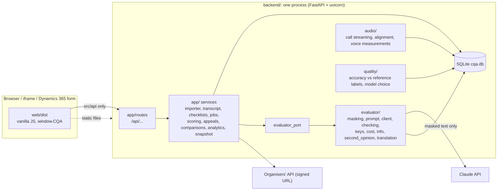
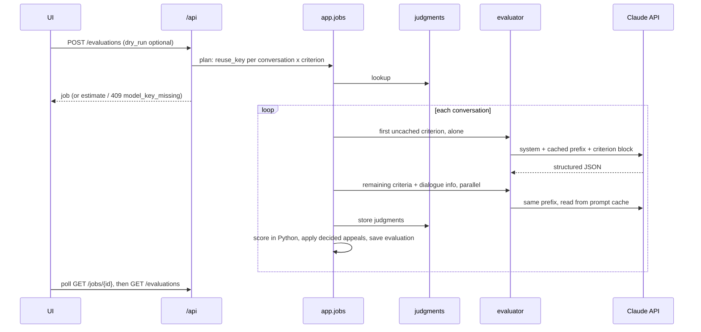

# Architecture

How CQA (Conversation Quality Analytics) is built and why. This file is the map. Details that
already live elsewhere are linked, not copied:

- Setup and configuration: [`README.md`](README.md) and `backend/.env.example`
- HTTP API: `/api/openapi.json` on a running server
- API contract: [`contract/`](contract/) (JSON Schemas and examples)
- Evaluator step plan: [`backend/evaluator/PLAN.md`](backend/evaluator/PLAN.md)

## 1. What the system does

A user picks a checklist, runs an evaluation of an operator's dialogue, and sees a per-criterion
answer, score, explanation and the evidence line. A controller can appeal a criterion. A reviewer
confirms or changes the answer, and the total is recalculated.

Three principles drive every decision:

1. **The model answers, Python scores.** The LLM judges one criterion at a time. All arithmetic
   (weights, N/A redistribution, rounding, appeal outcomes) is exact code, so totals are
   reproducible and cost nothing to recompute.
2. **Nothing is asked twice.** Every judgment is stored under a key built from everything the
   model saw. Unchanged input means no model call.
3. **The UI must stay embeddable in Dynamics 365.** Static files, one data adapter, strict CSP
   (see section 8).

## 2. Components

| Layer | Path | Owns |
|---|---|---|
| UI | `web/` | Vanilla JS, esbuild bundle in committed `web/dist/`, mock adapter for offline dev |
| Platform | `backend/app/` | Storage, import, scoring, jobs, appeals, reports, snapshot, HTTP routes |
| Evaluator | `backend/evaluator/` | Everything that talks to the model |
| Audio | `backend/audio/` | Streaming call audio through the backend, VAD, alignment of transcript to audio, voice measurements |
| Quality | `backend/quality/` | Accuracy report against reference answers, per-criterion model choice |
| Contract | `contract/` | JSON Schemas both the UI mock and backend models are tested against |
| Checklists | `checklists/` | Official checklist seeds (locked) and call checklist |

`app/main.py` mounts `<package>.router.router` for each of `evaluator`, `audio` and `quality`
that exists, so streams plug in without editing the app. Each stream registers its own table
migrations (`c_` prefix for the evaluator).

## 3. Domain model

- **Conversation**: id is `{group_id}:{conversation_id}`. Channel is chat or voice call. Language
  RU, KZ or EN. The transcript keeps the original timestamps (`MM:SS` for chats, ISO 8601 for
  calls). Speakers are `client`, `operator`, `bot`, `system`. Duplicate lines are marked, never
  removed, so message indices never shift.
- **Facts** (computed in code, `app/transcript.py`): operator joined, first reaction seconds
  (and the 3-minute check), longest wait, identity verified, ending type.
- **Checklist version**: immutable. Sections, criteria, shared `guidance`, rounding rules. A
  change creates a new version. The official seed is locked and can only be copied.
- **Criterion**: kind `scored` or `gross_error`, answer type `yes_no` or `scale`, weight, scale
  steps, N/A rule, allowed gross-error kinds, optional own guidance and own model. The server
  computes its **fingerprint** (title, wording, answer type, scale, N/A rule, kinds, guidance;
  not weight, order or section).
- **Judgment**: answer, explanation, evidence (message index, verbatim quote, role), checked
  range, confidence, `needs_review`, coaching, model, reuse key, paid calls.
- **Evaluation**: one conversation, one checklist version, results, `original_total` and
  `final_total`, cost.
- **Appeal**: criterion under dispute, comment, second opinion, reviewer decision. Stores the
  fingerprint and transcript hash it was filed against (the carry-forward key).

Tables: `conversations`, `checklist_versions`, `judgments`, `evaluations`, `jobs`, `appeals`
(platform) and `c_llm_calls`, `c_translations` (evaluator). Each row is validated JSON plus the
columns that are queried. See README for the ER diagram.

## 4. The official checklist

Weights sum to 100. Same checklist for RU, KZ and EN.

| Id | Section | Criterion | Weight | Answer | N/A |
|---|---|---|---|---|---|
| c01 | Start | Establishing contact | 10 | yes/no | no |
| c02 | Start | Identifying the need | 15 | yes/no | yes |
| c03 | Safety | Identification | 20 | yes/no | yes |
| c04 | Safety | Correct and complete consultation | 20 | scale 0/5/10/15/20 | yes |
| c05 | Conduct | Empathy | 15 | yes/no | no |
| c06 | Conduct | Dialogue management, speed, literacy | 15 | scale 0/4/7/10 | no |
| c07 | Conduct | Closing | 5 | yes/no | yes |
| c08 | Gross | Gross errors (`insult`, `paid_service_outside_company`, `confidential_disclosure`) | 0, flag | yes/no | no |

"No" means the action was needed and missed. N/A means the criterion does not apply. A required
identity check that is not confirmed in the chat is "No", not N/A. Team interpretations are added
as `guidance` without changing the official wording.

## 5. Evaluation pipeline

- Modes: `reuse` (default) and `full` (re-ask everything, refresh the cache).
- Concurrency: dialogues run concurrently. One process-wide semaphore (`MAX_PARALLEL_CALLS`, 8)
  bounds model calls. The first criterion of a dialogue runs alone so it writes the prompt cache
  the others read.
- Failures: one failed criterion does not fail the run. It is recorded with a reason and a
  `retryable` flag. After a restart, queued or running work is marked `interrupted` and can be
  retried. A missing key surfaces as `409 model_key_missing` before any work.

## 6. The evaluator

### 6.1 One criterion, one call (`judge.py`)

1. **Mask** personal data (`masking.py`): email, IBAN, card, IIN, phone, names found by cue
   phrases in RU/KZ/EN. Placeholders: `[ИМЯ]`, `[ТЕЛЕФОН]`, `[КАРТА]`, `[ИИН]`, `[СЧЁТ]`,
   `[EMAIL]`. The organisers' `[Имя скрыто]` is left alone.
2. **Build the prompt** (`prompt.py`). The system prompt names no criterion, weight or scale;
   everything comes from checklist data. Block 1 (cached) = checklist context + transcript
   `[index] time speaker: text` + facts (+ voice measurements for calls), byte-identical for all
   criteria of a dialogue. Block 2 = the criterion: title, wording, guidance, scale steps, N/A
   condition, an `Allowed answers` line.
3. **Call** with a JSON Schema (`CriterionOutput`): answer, step, kinds, explanation (Russian),
   evidence, checked range, N/A reason, confidence, coaching.
4. **Check in code** (`checking.py`).
   - Fatal: answer not allowed, N/A not allowed, step not in scale, gross-error kinds missing or
     not allowed.
   - Non-fatal: evidence index out of range, quote not found in the message (fuzzy match at
     0.85 for quotes of 12+ characters, after normalising case, `ё`, punctuation), missing
     checked range, missing N/A reason, empty explanation.
5. **One corrective retry**: a third block lists the problems; blocks 1 and 2 are unchanged so
   the cache holds. Still fatal means `JudgmentFailed("invalid_answer")`. Only non-fatal left
   means bad evidence is dropped and `needs_review` is set. Low confidence also sets
   `needs_review`.

### 6.2 Prompt-injection stance

Dialogue text and appeal comments are data, never instructions. `<transcript>` and
`<appeal_comment>` tags inside user text are neutralised to `‹…›`. `bot` and `system` lines are
context only and are not evidence of operator action.

### 6.3 Reuse keys (`keys.py`)

`sha256` of: prompt version, model, criterion fingerprint, checklist guidance, rendered checklist
context and criterion block, transcript hash, facts, voice measurements. Not in the key: weight,
order, rounding.

| Change | Model calls |
|---|---|
| Re-run, nothing changed | none |
| Weight only | none (totals recomputed, appeal decisions carry over) |
| New or reworded criterion, scale or N/A change | one per dialogue, that criterion only |
| Checklist name or shared guidance changed | all criteria |
| New or changed transcript | all criteria for that dialogue |

Bump `PROMPT_VERSION` (currently `c3`) on any change to the prompt, rendering or masking.

### 6.4 Other model calls

- **Dialogue info** (`info.py`): topic (about 8 words), client mood at start and end, outcome
  (`resolved`, `passed_to_specialists`, `unresolved`, `client_left`). Never affects a score.
- **Second opinion** (`second_opinion.py`): same cached prefix plus the original judgment and the
  appeal comment. Advises the reviewer, never decides. Unavailable without a key.
- **Translation** (`translation.py`): `GET /conversations/{id}/translation?to=ru`, cached in
  `c_translations`; same-language requests return the original with no call.

### 6.5 Models and cost

Default `claude-haiku-5-5` (USD 0.10 in / 0.50 out per 1M tokens); `claude-sonnet-5-5`
(2.00 / 10.00) can be set per criterion. Cost uses actual tokens: cache write 1.25x input, cache
read 0.10x. Each paid call is stored in `c_llm_calls`. Observed run (7 Nov 2026): all 65 DEV
dialogues, 613 calls, 0 failures, USD 0.27 (about USD 0.004 per dialogue), about 11 minutes. One
observed run, not a guarantee.

## 7. Scoring (`app/scoring.py`)

Pure function, `Fraction` arithmetic, one half-up rounding at the output. The browser has the same
algorithm on BigInt fractions (`web/src/domain/scoring.js`) for the mock adapter.

1. Value: yes = 1, no = 0, step = step / top step, N/A = not applicable.
2. Applicable = `scored`, weight > 0, not N/A.
3. Effective weight = weight x 100 / sum of applicable weights (N/A weight is spread over the
   rest).
4. Points = value x effective weight. Total = sum, or `None` ("not calculated") when nothing
   applies, never 0.
5. Gross error: weight 0. `yes` raises the flag and lists kinds; it never changes the total.
6. Sections: points, available, percent; all `None` when nothing in the section applies.
7. Totals come from exact values, so rounded per-criterion points may differ from the rounded
   total by a cent. Two totals per evaluation: `original_total` (model answers) and `final_total`
   (after appeals).

Invalid answers raise `ScoringError` with a code (`na_not_allowed`, `step_not_in_scale`,
`bad_answer`, `missing_answer`, `unknown_criterion`, `bad_scale`).

## 8. Appeals and review

- **File** (controller only): on a done evaluation, one open appeal per criterion per evaluation.
- **Second opinion** runs in the background; `pending`, then a result, or `unavailable`.
- **Decide** (reviewer only, reason required): `confirmed` or `changed` (validated against the
  criterion). The appeal, recalculated evaluation, carried decisions and dispute status are
  written in one transaction.
- **Carry-forward**: a decision applies to every later evaluation of the same conversation and
  transcript whose criterion has the same fingerprint, across checklists and versions. A rerun
  never silently undoes a reviewer. An evaluation's own decision outranks a carried one.
- Roles are a request field, not authentication. In Dynamics the host signs the user in.

## 9. Front end and Dynamics 365

Vanilla JS, no framework. `src/api/index.js` is the only module that calls `fetch`; `http.js`
targets the backend, `mock/` implements the same interface offline. All CSS is scoped under
`.cqa`. Context (conversation id, role, language, theme) comes from mount options, URL
parameters or `window.CQA.setClientApiContext(Xrm, formContext)`; the API base is read at runtime
from `config.js`.

The UI ships three ways without a rewrite: Dynamics web resources, an iframe of the hosted page,
or a later PCF wrapper. Constraints that keep this true:

- Static files and relative paths; web-resource file types only (font inlined as base64, config
  as JS).
- Strict CSP: no inline scripts, styles or handlers, no `eval`.
- Usable from 600 px wide; light theme by default when embedded; no login of its own.
- Backend: configurable `CORS_ORIGINS` (Dynamics origins) and `FRAME_ANCESTORS`.
- Proof: `dynamics-mock.html` runs the UI in a fake form under the strict CSP; e2e scenario
  `03-dynamics` checks it.

## 10. Data, privacy and security

- **Signed URLs** (organisers' data URL, every call's `audio_url`) live only in `backend/.env` and
  a private DB column. They never reach the browser, logs, snapshot or git. A log filter replaces
  them with `<redacted>`; the snapshot export refuses to write if `sig=` or `audio_url` appears.
- **Data to the model**: only masked dialogue text, only when a key is set, only for a new
  evaluation, second opinion or translation.
- **Audio** reaches the browser only through the backend.
- **Snapshot / keyless mode**: `uv run cqa-snapshot` exports conversations (no audio links),
  checklists, done evaluations, appeals and the judgment cache. It restores on first start into an
  empty database, so the jury can browse, appeal and compare without a key. Without
  `ANTHROPIC_API_KEY` everything stored works; only runs needing a model call return 409.
- **Never committed**: `backend/.env`, `data/dev.json`, `data/audio/`, organisers' PDFs, databases,
  run reports.
- **Headers**: strict CSP on HTML; CORS off unless configured, never with credentials; unhandled
  errors return a fixed message.

## 11. Testing

- Backend: `uv run pytest` from `backend/` (app tests); `uv run pytest evaluator/tests` for the
  evaluator. Tests never call the Claude API; models are replaced by `ScriptedCalls` and
  `FakeAsyncAnthropic` (`evaluator/testing.py`).
- Contract: JSON Schemas in `contract/` are validated against both the mock adapter and the
  backend models.
- Front end: `npm test` (unit, `node:test`), `npm run e2e` (headless Chrome over CDP, fails on any
  CSP violation, console error or horizontal overflow), `npm run check:dist` (committed build is
  fresh).

## 12. Known gaps

- Accuracy against reference answers (`backend/quality/`) exists, but no independent accuracy
  figure has been published yet; the slide placeholder is still open.
- Analytics and accuracy pages: backend endpoints work, UI pages are placeholders (#36, #37).
