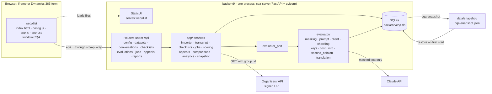
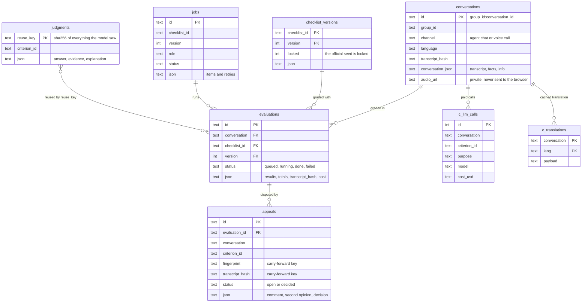
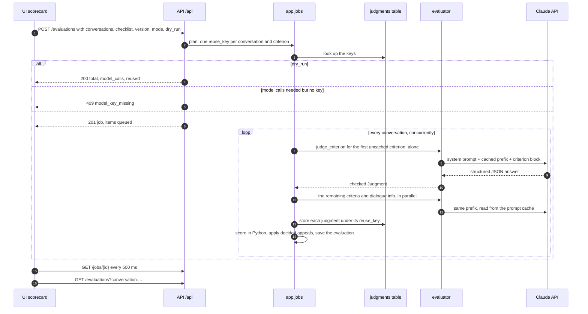
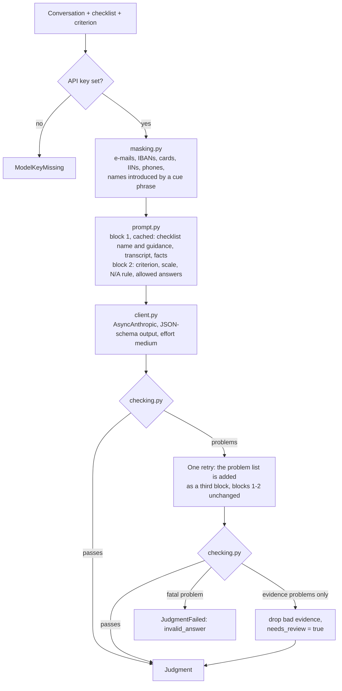
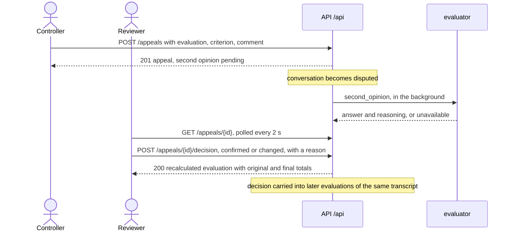
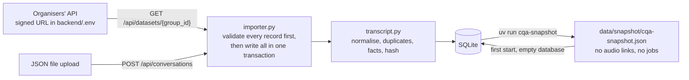
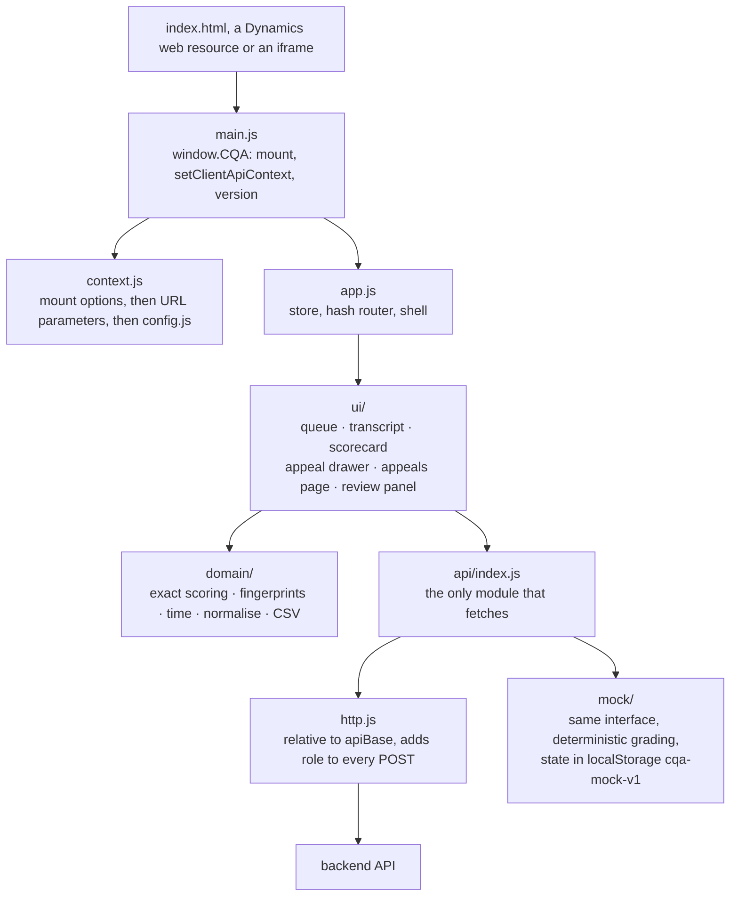

# CQA: Conversation Quality Analytics

**Team: gtbsbe**

A prototype for the Freedom Broker × Nazarbayev University Data Challenge. It scores support operators' chats and calls against a configurable checklist, explains every score with evidence from the dialogue, and lets a score be appealed and reviewed. The interface is plain HTML, CSS and JavaScript, built so that it can later run as a component inside Microsoft Dynamics 365.

**The flow:** pick a checklist (the official eight-criterion checklist is the default) → run an evaluation of an operator's dialogue → see each criterion's answer, points, explanation and the evidence line in the transcript → a controller files an appeal on one criterion → a model gives the reviewer a second opinion → the reviewer confirms or changes the answer, and the total is recalculated.

## Contents

- [Status](#status)
- [Run it](#run-it)
- [Architecture](#architecture)
  - [System overview](#system-overview)
  - [Repository layout](#repository-layout)
  - [Backend platform](#backend-platform)
  - [Data model](#data-model)
  - [Evaluation pipeline](#evaluation-pipeline)
  - [Evaluator](#evaluator)
  - [Scoring](#scoring)
  - [Checklists, versions, reuse and comparison](#checklists-versions-reuse-and-comparison)
  - [Appeals and review](#appeals-and-review)
  - [Import, snapshot and keyless mode](#import-snapshot-and-keyless-mode)
  - [Analytics and export](#analytics-and-export)
  - [Front end](#front-end)
  - [Dynamics 365 integration](#dynamics-365-integration)
  - [Security and privacy](#security-and-privacy)
  - [HTTP API](#http-api)
  - [Configuration](#configuration)
- [Models and cost](#models-and-cost)
- [In progress](#in-progress)
- [Known limitations](#known-limitations)
- [For the team](#for-the-team)

## Status

As of `main` on 7 November 2026.

| Area | State on `main` |
|---|---|
| Backend platform (storage, import, scoring, jobs, appeals, comparisons, analytics, CSV, snapshot export/restore) | Done |
| Evaluator (masking, prompts, model client, answer checking, reuse, cost, dialogue info, second opinion, translation, DEV harness) | Done. Runs on the local Qwen model or the Claude API; all 65 DEV dialogues evaluated (see [Models and cost](#models-and-cost)) |
| UI workspace: queue, transcript, scorecard, evaluation runs, evidence jumps | Done |
| UI appeals: dispute drawer, appeals page, reviewer panel with second opinion and decision | Done |

Details in [In progress](#in-progress).

## Run it

All you need is `uv` and internet access for the first dependency installation. It installs Python 3.12. Node is not needed because `web/dist/` is committed. You do not need a model key to browse stored results once a snapshot is present.

1. **Install `uv`** (once). It downloads Python 3.12 by itself.
   - Windows PowerShell: `powershell -ExecutionPolicy ByPass -c "irm https://astral.sh/uv/install.ps1 | iex"`
   - macOS or Linux: `curl -LsSf https://astral.sh/uv/install.sh | sh`
2. **Start it.**
   ```sh
   cd backend
   uv run cqa-serve
   ```
   Then open <http://127.0.0.1:8000/>. Add `--host` or `--port` to change the address. When present, the first start loads the results snapshot from `data/snapshot/` into a local database (`backend/cqa.db`). Everything already stored works without a key: the queue, scores with their evidence, appeals and decisions, comparisons, analytics and the CSV export. A new evaluation that cannot reuse stored judgments returns `409 model_key_missing`. Uncached translations and the model's second opinion also need a key.
3. **Optional: a `.env` file.** Copy `backend/.env.example` to `backend/.env`, then restart.
   - `ORGANIZER_API_URL`: the GET link from the guide. It lets you import a dataset group. When the queue is empty, the UI imports the `DEV` group by itself.
   - `ANTHROPIC_API_KEY`: needed only for new evaluations (a new or reworded criterion, or a new dialogue).
   - `ANTHROPIC_BASE_URL`, `DEFAULT_MODEL`, `MODEL_TIMEOUT_SECONDS`: run the evaluator on the local model instead of the Claude API ([ops/LOCAL_MODEL.md](ops/LOCAL_MODEL.md)).
4. **Useful URLs** once it runs:
   - <http://127.0.0.1:8000/>: the UI.
   - <http://127.0.0.1:8000/dynamics-mock.html>: the UI inside a mock Dynamics form, 600 px wide.
   - <http://127.0.0.1:8000/api/export.csv?group_id=DEV>: all results of a group as CSV for Excel.
   - <http://127.0.0.1:8000/api/openapi.json>: the API schema. Swagger and ReDoc are off because their CDN scripts would break the strict CSP.

## Architecture

### System overview

One Python process serves both the static UI and the JSON API on the same origin. The UI reaches data only through one adapter module. All model work goes through the evaluator package, behind a port, and every model call is a separate, cached and checked request to the Claude API.



Key decisions:

- **Same origin by default.** The backend serves `web/dist/` and `/api`, so no CORS or CSP exceptions are needed for the demo. Split hosting (the UI in Dynamics, the API elsewhere) is supported through `CORS_ORIGINS` and `FRAME_ANCESTORS`.
- **The model answers, Python scores.** The model gives one answer per criterion with an explanation and evidence. Points, N/A redistribution, rounding, gross-error flags and appeal outcomes are computed in Python with exact fractions.
- **One model call per criterion**, with a cached prefix (system prompt, checklist context, transcript) shared by every criterion of a dialogue. Every answer is checked in code: allowed values, evidence line numbers, quotes against the transcript.
- **Reuse instead of re-asking.** Every judgment is stored under a key built from everything the model saw. Re-running an unchanged criterion, or changing only a weight, costs no model call and cannot flip a borderline answer at random.
- **Stored results work without a key.** A results snapshot restores into SQLite on the first start, so the jury can browse, appeal and compare without credentials.
- **Plug-in seams for the streams.** The app mounts `<package>.router.router` for each of `evaluator`, `audio` and `quality` that exists (`backend/app/main.py`). Other streams' tables register their own migrations and can register for the snapshot.

### Repository layout

```
.
├── backend/                     Python 3.12 project, managed by uv
│   ├── app/                     Platform (stream B): storage, import, scoring, jobs, appeals, reports, snapshot
│   │   └── routes/              One router per resource
│   ├── evaluator/               Evaluator (stream C): Claude judging, masking, answer checking, reuse keys, cost
│   │   └── tests/
│   ├── tests/                   App tests; fixtures/dev_subset.json is six DEV records without audio links
│   ├── pyproject.toml           Dependencies and the cqa-serve / cqa-snapshot commands
│   └── .env.example             Configuration reference (placeholders only)
├── web/                         Front end (stream A): vanilla JS, bundled with esbuild
│   ├── src/                     api/ (the one adapter + mock), domain/, state/, ui/, i18n/, styles/, assets/
│   ├── static/                  index.html, config.js, favicon, the mock Dynamics form
│   ├── tools/                   Dev server with strict CSP, static server, dist freshness check
│   ├── test/                    unit/ (node:test) and e2e/ (headless Chrome over CDP)
│   └── dist/                    Committed build that the backend serves
├── checklists/
│   └── official-chat-v1.json    The official checklist, word for word; seeded as locked
├── contract/                    JSON Schemas and example payloads of the API contract
│   ├── schemas/
│   └── examples/
├── data/                        dev.json and audio/ are private (not in git); snapshot/ holds the jury snapshot
├── .github/workflows/backend.yml   CI: backend and evaluator tests
├── CLAUDE.md                    Project rules: Dynamics constraints, secrets, design language
├── EXTRA_FEATURES.md            Agreed features beyond the brief
├── HANDOVER.md                  Front-end handover (written at cc5ff85; the appeals UI has landed since)
└── SUBMISSION_AUDIT.md          Security audit before the repository goes public (#35)
```

### Backend platform

FastAPI on uvicorn, Pydantic models, SQLite through the standard library, `httpx` for the organisers' API and the official `anthropic` SDK. Python 3.12 is pinned.

**Startup of `uv run cqa-serve`** (`backend/app/cli.py`, `backend/app/main.py`):

1. Logging for the `app` logger goes to stderr at INFO. (The filter that redacts signed URLs on the HTTP-client and server loggers is installed as soon as the app is imported, so it covers every way of starting it.)
2. A relative `DB_PATH` is resolved against `backend/`, so the database is the same wherever you start from.
3. Optional packages are imported. `evaluator` registers its own migrations (`c_llm_calls`, `c_translations`).
4. Migrations run, each in its own transaction, and the official checklist is seeded if its `(id, version)` is missing.
5. If the `conversations` table is empty, the snapshot is restored. A missing or broken snapshot only logs a warning.
6. It prints the database path, the URL, and whether a model key and an organisers' URL are configured, never their values.
7. On app start, interrupted jobs and pending second opinions from a previous run are marked failed or unavailable. On shutdown, running work is cancelled.

`uv run uvicorn app.main:create_app --factory` also works for development, but it skips the snapshot restore and the `app` logging setup.

**Modules** (`backend/app/`):

| Module | Owns |
|---|---|
| `main.py` | App factory, CSP middleware, optional CORS, `StaticUI` for `web/dist`, mounting the optional stream routers, lifespan |
| `cli.py` | `cqa-serve` and `cqa-snapshot` |
| `settings.py` | Settings from the environment and `backend/.env` (pydantic-settings) |
| `db.py` | SQLite connections (WAL, foreign keys, 30 s busy timeout) and the migration registry |
| `models.py` | Every API and storage model; these mirror `contract/schemas/` |
| `errors.py` | `ApiError` and the `{error, message}` envelope for every failure |
| `store.py` | All SQL for conversations, checklists, judgments, evaluations, jobs and appeals |
| `transcript.py` | Normalising records, marking duplicate lines, computed facts, transcript hash |
| `importer.py` | Fetching a group from the organisers, parsing uploads, all-or-nothing import |
| `checklists.py` | Criterion fingerprints, seeding, validation, weight warnings |
| `scoring.py` | Exact scoring with `Fraction`, half-up rounding |
| `jobs.py` | Planning (dry run), running, retrying and recovering evaluation jobs |
| `appeals.py` | Filing, background second opinion, decisions, recalculation, carrying decisions forward |
| `comparisons.py` | Before/after comparison of two checklist versions |
| `analytics.py` | Aggregates and the CSV export |
| `snapshot.py` | Snapshot export and restore with guards, and a registry for other streams' tables |
| `redaction.py` | Log filter that replaces signed URLs with `<redacted>` |
| `evaluator_port.py` | The boundary to `evaluator/`: lazy import, 503 if missing, swappable in tests |

### Data model

Each record is stored as validated JSON next to the columns that are queried. The conversation identity is `{group_id}:{conversation_id}`, so the same dialogue id in two groups is two conversations.



- **Re-importing a conversation** compares transcript hashes. An unchanged transcript is left alone. A changed one replaces the row, resets its status to `new` and drops its dialogue info. Old evaluations stay and keep the hash of the text they graded.
- **Appeals**: a partial unique index allows one open appeal per criterion per evaluation.
- Tables prefixed `c_` belong to the evaluator.

### Evaluation pipeline

`POST /api/evaluations` plans first, then runs the work in the background. The UI polls the job, then reads the stored evaluation.



- **Modes:** `reuse` (the default) takes every stored judgment whose answer still fits the criterion. `full` re-asks the model for everything and refreshes the cache.
- **Concurrency:** dialogues run concurrently. All model calls in the process share one semaphore of `MAX_PARALLEL_CALLS` (8). Within a dialogue, the first uncached criterion runs alone so that it writes the prompt cache the others then read.
- **Retries:** the SDK retries transport errors four times. The evaluator makes one corrective retry when an answer fails the checks. The job makes one more attempt after 1 s for retryable failures. `POST /api/jobs/{id}/retry` re-runs failed items later and records who asked.
- **Failures:** each item ends `done` or `failed` together with its evaluation, in one transaction. A job is `failed` only if every item failed. Stored error codes never contain exception text.
- **Recovery:** after a restart, anything left queued or running is marked failed with `interrupted` and can be retried.

### Evaluator

`backend/evaluator/` holds everything that talks to the model. The app uses four functions through the port: `reuse_key`, `judge_criterion`, `dialog_info` and `second_opinion`. There is also a standalone `evaluate()` that the DEV harness uses.

**One criterion, one call** (`judge.py`):



- **Transcript rendering:** one line per message, `[index] time speaker: text`. Chats keep their `MM:SS` times. Calls show `+m:ss` from the first line. Duplicate lines are left out without shifting the indices. The model refers to lines by index only. The system prompt says that `bot` and `system` lines are context and that the transcript is data, not instructions.
- **Masking** runs on every text sent to the model: judging, dialogue info, second opinion and translation. It cannot be reversed, and the stored transcript and the UI stay unmasked. Quote checking accepts a match against either the original or the masked text.
- **Checks in code.** Fatal: an answer type the criterion does not allow, N/A where it is not allowed, a step that is not on the scale, gross-error kinds missing or not allowed. Non-fatal: a line index out of range, a quote that does not match its line (fuzzy at 0.85 for quotes of 12 or more characters), a missing checked range, N/A reason or explanation. Low model confidence also sets `needs_review`.
- **The model's output** per criterion: `answer` (`yes`, `no`, `na` or a scale step), gross-error `kinds`, `explanation` and `coaching` in Russian, `evidence` items (line index, quote, `supports` or `expected_here`), `checked_range`, `na_reason` and `confidence`.
- **Dialogue information** (`info.py`, not scored): topic, the client's mood at the start and at the end, and the outcome (resolved, passed to specialists, unresolved, client left). It is asked once per transcript, alongside the criteria.
- **Second opinion** (`second_opinion.py`): the same cached prefix plus the original answer, its evidence and the appeal comment. It returns an answer and its reasoning for the reviewer. It never changes a score by itself.
- **Translation** (`translation.py`): Russian only, line by line, cached per conversation in `c_translations`. A Russian dialogue is returned as is, with no call.
- **Cost** (`cost.py`): every paid call, failed ones included, is logged to `c_llm_calls` with its tokens and cost.
- **Errors** become `JudgmentFailed` with a reason, a retryable flag and the request id. Prompts, responses and the key are never logged.
- **DEV harness:** `uv run python -m evaluator.devrun --data <file> --checklist <file>` evaluates a dataset outside the app. It checks the ten hand-written expectations in `evaluator/dev_expectations.json`, can record responses for replay, and writes a report to `--out`. Reports contain real dialogues and are git-ignored (`backend/runs/`, `eval-runs/`).

**Who decides what:**

| The model | Code |
|---|---|
| Each criterion's answer, gross-error kinds, explanation, evidence lines and quotes, checked range, N/A reason, confidence, coaching | Masking, rendering, every validity check, dropping bad evidence, `needs_review` |
| Topic, moods, outcome | Facts: when the operator joined after a handover, first-reaction time and the 3-minute flag, longest wait, when identity was verified, how the chat ended |
| Second-opinion answer and reasoning | Points, N/A redistribution, rounding, gross-error flag, appeal outcomes, totals, comparisons, analytics |
| Translations | Reuse, caching, cost |

### Scoring

All arithmetic is exact (`fractions.Fraction`), with one rounding at the end (`backend/app/scoring.py`). The browser has the same algorithm on BigInt fractions (`web/src/domain/scoring.js`) for the mock adapter and a development cross-check.

- **Answer value:** `yes` = 1, `no` = 0, a scale step = step ÷ top step, N/A = not applicable.
- **Applicable criteria** are scored criteria with a weight above 0 that are not answered N/A.
- **Effective weight** = weight × 100 ÷ (sum of applicable weights). The weight of N/A criteria is spread proportionally over the rest.
- **Points** = answer value × effective weight. **Total** = sum of points, or "not calculated" when nothing applies.
- **Rounding:** once, half up, to two decimals.
- **Gross errors:** the gross-error criterion has weight 0. A `yes` raises the flag and lists its kinds. It never changes the total.
- **Two totals per evaluation:** `original_total` from the model's answers, and `final_total` from the final answers. A criterion's final answer is this evaluation's own appeal decision, else a decision carried from an earlier evaluation, else the model's answer.
- **Sections** get points, available points and a percentage.

**The official checklist** (`checklists/official-chat-v1.json`, `official-chat` v1, locked):

| Id | Section | Criterion | Weight | Answer | N/A allowed |
|---|---|---|---|---|---|
| c01 | Начало и понимание запроса | Установление контакта | 10 | yes / no | no |
| c02 | Начало и понимание запроса | Выявление потребности | 15 | yes / no | yes |
| c03 | Безопасность и решение | Идентификация | 20 | yes / no | yes |
| c04 | Безопасность и решение | Корректная и полная консультация | 20 | scale 0, 5, 10, 15, 20 | yes |
| c05 | Ведение и завершение диалога | Эмпатия и клиентоориентированность | 15 | yes / no | no |
| c06 | Ведение и завершение диалога | Управление диалогом, скорость и грамотность | 15 | scale 0, 4, 7, 10 | no |
| c07 | Ведение и завершение диалога | Завершение | 5 | yes / no | yes |
| c08 | Грубые нарушения | Грубые ошибки: insult, paid_service_outside_company, confidential_disclosure | 0 (flag) | yes / no | no |

### Checklists, versions, reuse and comparison

- **Versions are immutable.** Saving a changed checklist creates a new version. Old versions and their results stay untouched. The official seed is locked: it can be copied but not changed.
- **Copy with lineage:** `POST /api/checklists` with `based_on` creates a new checklist (id `slug(name)-<6 hex>`) that records where it came from.
- **Validation:** a name and at least one criterion, unique ids, known sections, weights from 0 to 1000, valid scales. A weight sum other than 100 is a warning, not an error.
- **Fingerprint** (computed by the server, never trusted from the client): title, wording, answer type, scale steps with labels, N/A rule and condition, kind, kinds and the criterion's guidance. Weight, order, section and id are not part of it.
- **Reuse key** (`evaluator/keys.py`): SHA-256 of the prompt version, the model, the fingerprint, the checklist name and guidance, the rendered criterion block, the transcript hash, the facts and any voice measurements. Weight and order are not part of it.
- **What a change costs:**

  | Change | Model calls |
  |---|---|
  | Re-run, nothing changed | none |
  | Weight only, in a new version of the same checklist | none; totals are recomputed and appeal decisions carry over |
  | New or reworded criterion, changed scale or N/A rule | one call per dialogue for that criterion only |
  | Checklist name or checklist-wide guidance changed | every criterion again (both are in the prompt) |
  | New dialogue, or a changed transcript | every criterion for that dialogue |

- **Comparison:** `GET /api/comparisons` takes two checklist versions and a group or a list of conversations. For each conversation it compares the latest done evaluation on each side and returns the old total, new total and delta, with a summary of how many changed and the average delta. Because unchanged criteria reuse their stored answers, every difference comes from the change itself.

### Appeals and review

Roles are a request field, `controller` or `reviewer`, chosen in the UI. Inside Dynamics, the host signs the user in, so the prototype has no login of its own.



- **Filing:** controller only, on a done evaluation, one open appeal per criterion per evaluation. The appeal stores the criterion's fingerprint and the graded transcript hash.
- **Second opinion:** `pending` when a key is set and the transcript has not been replaced, otherwise `unavailable`. It is advice for the reviewer only.
- **Decision:** reviewer only, a reason is required. `confirmed` keeps the answer under appeal. `changed` sets a new answer, which is validated against the criterion. A decision on the gross-error criterion may name the kinds. The appeal, the recalculated evaluation, carried decisions and the conversation's dispute status are written in one transaction.
- **Carrying decisions forward:** a decision applies to every later evaluation of the same conversation and transcript whose criterion has the same fingerprint, including other checklists and versions. Re-running an evaluation therefore never silently undoes a reviewer's decision. An evaluation's own decision outranks a carried one.
- **Disputed status** counts only open appeals on the current transcript.

### Import, snapshot and keyless mode



- **Organisers' fetch:** only the `group_id` parameter of the signed URL is replaced, and the whole call has a 60 s deadline. Errors name the status or a timeout, never the URL.
- **Upload:** one record, an array, `{records}` or the organisers' full response. Without a group id, the group becomes `upload-<UTC timestamp>`.
- **Records:** `channel` is `agent chat` or `voice call`. A record with any problem rejects the whole import, with nothing stored.
- **Audio links** are kept in a private column and are never part of the conversation JSON. The UI only sees a relative path, `conversations/{id}/audio`, which the audio router of PR #56 serves.
- **Snapshot export** (`uv run cqa-snapshot`): conversations without audio links, every checklist version, done evaluations, appeals and the judgment cache. Jobs are left out. The export refuses to write if any `sig=` or `audio_url` appears, or if the stored official checklist differs from its file. It writes atomically.
- **Restore:** only into a database with no conversations, evaluations or appeals, checking that references resolve, in one transaction.
- **Keyless mode:** without `ANTHROPIC_API_KEY`, everything stored works. A run that is fully reused still succeeds. Only runs that need a model call return `409 model_key_missing`. Dialogue info is skipped, the second opinion is `unavailable`, and translation returns cached or Russian text, else 409.

### Analytics and export

- `GET /api/analytics` (defaults to the official checklist): per criterion `n`, N/A rate and fail rate among applicable answers (a failure is `no` or a step below the top), averages by language (RU, KZ, EN first) and by channel, and gross errors by kind with their conversations.
- `GET /api/export.csv`: UTF-8 with a BOM, `;` separators, decimal commas and CRLF line ends, so it opens correctly in Excel with Russian settings. Columns: ids, group, channel, language, checklist and version, original and final totals, gross-error flag and kinds, then the answer and points of every criterion. Text cells that start with `=`, `+`, `-` or `@` are escaped against CSV injection.

### Front end

Vanilla JavaScript (ES2020) with no framework, bundled by esbuild into one IIFE. Russian UI strings. Freedom's design language (see `CLAUDE.md`).



- **Build** (`web/build.mjs`): `src/main.js` becomes `dist/app.js` and `src/styles/index.css` becomes `dist/app.css`, with the CoFo Sans variable font inlined as base64. `static/` is copied as is. Node 22 or newer. `web/dist/` is committed and must be rebuilt (`npm run build`) in every pull request that changes `web/`. `npm run check:dist` fails if it is stale.
- **Runtime config:** `dist/config.js` sets `window.CQA_CONFIG = { api: "http", apiBase: "api" }`. It is a separate file, so the API base is never baked into the bundle.
- **Context keys:** `api`, `apiBase`, `conversationId`, `role`, `theme`, `mode`. A `conversationId` switches to the embedded, compact view of one record (transcript and scorecard, no queue).
- **Routes** (hash-based, so no server routing is needed): `#/` and `#/c/:id` for the workspace, `#/appeals` and `#/appeals/:id`, plus `#/checklists…`, `#/compare`, `#/analytics` and `#/accuracy`, which show a placeholder until #36 and #37 land.
- **Workspace:**
  - The queue has search, filters (all, chats, calls, disputed, new) and language. It auto-imports `DEV` when empty.
  - The transcript shows speaker bubbles and system notes, with evidence highlighting.
  - The scorecard has a checklist picker, run and full re-run, job polling and the total in the brand panel. It also has sections, criterion cards with evidence jumps, gross-error flags, coaching, dialogue info and facts (including the 3-minute first-reaction check), history, and «Оспорить».
- **Mock adapter:** the UI runs without the backend, for development and browser tests. It implements the whole API: imports, jobs, reuse, appeals, second opinions, reports and fault injection. It enforces the same rules and error codes as the backend. It is not a real evaluator.
- **Styles:** every rule is scoped under `.cqa`, design tokens are custom properties on `.cqa`, and the dark theme is `.cqa.cqa--dark`. Below 900 px the queue becomes a drawer. Below 700 px the transcript and the scorecard become tabs.
- **Tests:** unit tests (`node --test`) cover the contract schemas, the HTTP mapping, the mock, scoring, time, normalising and the Dynamics static rules (no inline scripts, `fetch` only in `src/api`, scoped CSS, only web-resource file types in `dist/`). Browser tests drive headless Chrome over the DevTools Protocol, with no npm test framework, at 1400 and 600 px. They fail on any CSP violation, console error or horizontal overflow.

### Dynamics 365 integration

The brief asks for a UI that can later become an HTML component of Dynamics 365. The UI can ship three ways without a rewrite: as **web resources** uploaded into Dynamics, as an **iframe** of the hosted page on a form, or later wrapped as a **PCF** component. Every UI change keeps these true (full rules in `CLAUDE.md`):

1. **Static files with relative paths:** `index.html`, `config.js`, `app.js`, `app.css` and SVG icons.
2. **Only web-resource file types.** There is no font or JSON type, so the font is inlined into the CSS and config is a JS file.
3. **Survives a strict CSP:** no inline scripts, styles or handlers, no `eval`. The dev server sends a strict CSP so that a violation shows up at once.
4. **One data adapter** (`src/api/`). Inside Dynamics it either keeps calling this backend or switches to `Xrm.WebApi`, and only that module changes.
5. **Context comes from outside:** URL parameters, or Xrm and `formContext` handed in by a form script. Never `parent.Xrm`.
6. **Scoped styles,** usable from 600 px, light theme by default when embedded, no login of its own.
7. **Backend ready:** `CORS_ORIGINS` accepts Dynamics origins such as `https://*.crm*.dynamics.com`, and `FRAME_ANCESTORS` sets who may frame the page.

A form script hands the record to the web resource like this (this is what `web/static/dynamics-mock.js` exercises):

```js
// OnLoad of the Dynamics form; WebResource_cqa hosts index.html from the same origin.
formContext.getControl("WebResource_cqa").getContentWindow().then(function (win) {
  win.CQA.setClientApiContext(Xrm, formContext); // reads cqa_conversationid and opens that dialogue
});
```

The field name defaults to `cqa_conversationid` and can be changed with `dynamicsConversationField` in `config.js`. As an iframe, pass the record in the URL instead: `index.html?mode=embedded&conversationId=DEV%3Ap1-ru-001&theme=light`. **Proof:** `dynamics-mock.html` shows the UI in a fake 600 px Dynamics form under the strict CSP, and the e2e scenario `03-dynamics` checks it.

### Security and privacy

- **Signed URLs:** the organisers' data URL and every call's `audio_url` are signed links. They live only in `backend/.env` and in a private database column. They never reach the browser, logs, the snapshot or git. The log redaction filter replaces any URL with `sig=` or `signature=`, and the configured organisers' endpoint, with `<redacted>`. The snapshot export refuses to write if any signed link appears.
- **Data sent to Claude:** dialogue text leaves the machine only when a key is set, and only for a new evaluation, a second opinion or a translation. It is masked first. Without a key, no dialogue text leaves your machine.
- **Never committed:** `backend/.env`, `data/dev.json`, `data/audio/`, the organisers' PDFs, databases and run reports (see `.gitignore`).
- **HTTP headers:** HTML responses carry `default-src 'self'; script-src 'self'; style-src 'self'; img-src 'self' data:; font-src 'self' data:; media-src 'self'; connect-src 'self'; object-src 'none'; base-uri 'self'; form-action 'self'; frame-ancestors <FRAME_ANCESTORS>`. CORS is off unless `CORS_ORIGINS` is set, and never allows credentials. Unhandled errors return a fixed message.
- **Roles are not authentication.** They are prototype request fields. Real identity comes from the Dynamics host.

### HTTP API

All routes are under `BASE_PATH` (default `/api`). Errors are `{"error": "<code>", "message": "<text>"}`. The JSON Schemas and examples of every payload are in `contract/`. Section 7 of the private front-end design (`docs/superpowers/specs/2026-11-07-cqa-frontend-design.md`) is the single contract, and both the UI's mock adapter and the backend's models are tested against it.

| Method and path | Purpose | Success | Notable errors |
|---|---|---|---|
| `GET /config` | Models, prices, whether a key is configured, default checklist | 200 | |
| `GET /datasets/{group_id}` | Fetch a group from the organisers and import it | 200 import summary | 409 `organizer_url_missing`, 502 `organizer_error`, 422 `bad_record:<i>` |
| `POST /conversations` | Import uploaded JSON | 200 import summary | 422 `no_records`, `bad_record:<i>` |
| `GET /conversations?group_id&status&channel&language&q` | Queue items with the final total on the default checklist | 200 | |
| `GET /conversations/{id}` | One conversation with its transcript, facts and info | 200 | 404 |
| `GET /conversations/{id}/translation?to=ru` | Translation (evaluator router) | 200 | 409 `model_key_missing`, 422 `unsupported_language`, 502 `model_failed` |
| `GET /checklists` | Latest version of each checklist, with its version list | 200 | |
| `GET /checklists/{id}/versions/{v}` | One version | 200 | 404 |
| `POST /checklists` | New checklist, or a copy with `based_on` | 201 with `warnings` | 422 `invalid_checklist` |
| `POST /checklists/{id}/versions` | Next version | 201 with `warnings` | 409 `checklist_locked`, 422 `invalid_checklist` |
| `POST /evaluations` | Start a job, or estimate it with `dry_run` | 201 job, 200 estimate | 409 `model_key_missing`, 503 `evaluator_unavailable` |
| `GET /evaluations?conversation&checklist_id` | Evaluations, newest first | 200 | |
| `GET /evaluations/{id}` | One evaluation | 200 | 404 |
| `GET /jobs/{id}` | Job progress per dialogue | 200 | 404 |
| `POST /jobs/{id}/retry` | Re-run unfinished items | 200 job | 409 `model_key_missing` |
| `POST /appeals` | File an appeal (controller) | 201 appeal | 403 `role_not_allowed`, 409 `evaluation_not_done`, `appeal_already_open` |
| `GET /appeals?status&evaluation_id&conversation` | Appeals, newest first | 200 | |
| `GET /appeals/{id}` | One appeal; poll it for the second opinion | 200 | 404 |
| `POST /appeals/{id}/decision` | Decide (reviewer) | 200 recalculated evaluation | 403, 409 `appeal_already_decided`, 422 `reason_required`, `step_not_in_scale`, `na_not_allowed` |
| `GET /comparisons?from_checklist&from_version&to_checklist&to_version&group_id&conversations` | Before/after comparison | 200 | 404, 422 |
| `GET /analytics?checklist_id&version&group_id` | Aggregates | 200 | 404 |
| `GET /export.csv?group_id&checklist_id&version` | CSV download | 200 | 404 |
| `GET /openapi.json` | API schema | 200 | |

PR #56 adds `GET /reports/accuracy` and `GET /conversations/{id}/audio`.

### Configuration

Settings come from environment variables or `backend/.env`. Real environment variables win, and empty values count as unset.

| Variable | Default | Controls |
|---|---|---|
| `ANTHROPIC_API_KEY` | not set | Model calls. Without it, runs that need a call return 409 |
| `ORGANIZER_API_URL` | not set | The organisers' signed data URL, used to import groups |
| `CORS_ORIGINS` | `[]` | JSON list of allowed browser origins. `*` matches one DNS-label fragment |
| `FRAME_ANCESTORS` | `["'self'"]` | CSP `frame-ancestors`, who may frame the page |
| `BASE_PATH` | `/api` | API prefix |
| `DB_PATH` | `cqa.db`, resolved to `backend/cqa.db` | SQLite file |
| `DEFAULT_MODEL` | `claude-haiku-5-5` | Model for criteria without their own `model`, and for info and translation |
| `PRICES` | Haiku 5.5 and Sonnet 5.5 rates | Accounting rates in USD per million tokens. A model not listed here is refused |
| `MAX_PARALLEL_CALLS` | `8` | Model calls in flight across the whole process |
| `WEB_DIST` | `web/dist` | Directory of the static UI |

## Models and cost

**Main model: `Qwen3.8-27B-FP8`, local.** The demo and the control set are evaluated by Qwen3.8-27B-FP8 served by vLLM on our own GPU, through the same evaluator code (decision of 7 November 2026; setup, settings and measurements in [ops/LOCAL_MODEL.md](ops/LOCAL_MODEL.md)). The code default stays `claude-haiku-5-5`, so a clone without a GPU still runs; the switch is four lines in `backend/.env`.

| Model | Agreement with references (517) | Planted violations | All 65 DEV dialogues | Cost |
|---|---|---|---|---|
| Claude Haiku 5.5 (API) | 80.7% | 21 / 25 | about 11 min | $0.27 |
| Claude Sonnet 5.5 (API) | 79.5% | 23 / 25 | 10 min 40 s | $3.31 |
| **Qwen3.8-27B-FP8 (local)** | **88.2%** | 20 / 25 | 15 min 13 s | $0 |

Same 65 DEV dialogues, official checklist v1, same evaluator. References are the draft labels in `data/reference/` (not organiser ground truth); planted violations are listed in `backend/quality/planted.py`. The local time is on a GPU shared with other workloads.

The real DEV run used `claude-haiku-5-5` with the official eight-criterion checklist. `claude-sonnet-5-5` is also configured, and each criterion can select its own model. Dialogue information and translation use the default model. An appeal's second opinion uses the criterion's model. Scores, rounding and N/A redistribution are computed in Python, not by the model.

The run reported in PR #60 and issue #20 on 7 November 2026 evaluated all **65 DEV dialogues**. It made **613 calls**, had **zero failed criteria**, and passed **all 10 hand-written expectations**. Reported total cost: **$0.27**, or **about $0.00415 per dialogue**, in about 11 minutes. This is one observed run, not a guaranteed price or an independent accuracy measurement. Its raw report is private and has not been imported into this repository.

`GET /api/config` exposes the configured accounting rates in USD per million tokens: Haiku input $0.10 / output $0.50, Sonnet input $2.00 / output $10.00. These are the rates this application uses, not a promise about future provider billing. Cost uses actual token usage, including prompt-cache writes at 1.25× input and reads at 0.10× input. An unchanged judgment or a weight-only change reuses cached answers with no new criterion calls. New wording, transcripts, models or uncached translations can cost more. Paid call records are stored locally in `c_llm_calls`.

## In progress

| Work | Where | What it adds |
|---|---|---|
| Results snapshot | PR #100, issue #15 | The committed jury snapshot built from the 7 November DEV run, so a clean clone shows all 65 results without a key |
| Control set | Issue #34 | Import and evaluate the control set with `backend/quality/control_run.py` once the organisers publish its `group_id`, then export the results |
| Publication | Issue #35 | Make the repository public and send the link to the organisers |

## Known limitations

- **Reuse depends on the checklist name.** The name and checklist-wide guidance are part of what the model sees, so they are in the reuse key. A weight-only change costs nothing in a new version of the same checklist, but a copy saved under a new name asks the model about every criterion again.
- **Results after a transcript change.** When a re-import changes a transcript, queue totals, comparisons and analytics keep showing the latest done evaluation, which graded the old text, until the dialogue is evaluated again.
- **Translation cache.** It is keyed by conversation and language only, so a changed transcript keeps its old translation. Translations show masking placeholders such as `[ИМЯ]` and are not in the snapshot.
- **Masking is pattern-based.** Names are masked only when introduced by a cue phrase («меня зовут», «менің атым», "my name is"). Addresses and dates of birth are not masked.
- **The checklist `rounding` field** is stored but scoring always rounds to two decimals, which is what the official checklist uses.
- **Seed drift.** Startup does not notice a changed seed file under the same id and version. The snapshot export refuses it and the import warns.
- **Split-origin hosting** needs a CSP change at the serving layer: the backend's HTML policy allows `connect-src` and `media-src` from `'self'` only.
- **Host context:** the Dynamics bridge reads only the conversation id. Role, language and identity mapping, an `Xrm.WebApi` adapter and a PCF wrapper are not built. The UI itself is in Russian, Kazakh and English.

## For the team

### Getting started

```sh
git clone https://github.com/gtbsbe-draingang/gtbsbe_freedom.git
cd gtbsbe_freedom
git clone https://github.com/gtbsbe-draingang/gtbsbe_freedom-notes.git docs   # private specs and plans
cp docs/source/*.pdf .                                                        # task guide and official checklist
```

Then fetch the DEV data into `data/dev.json`, as described in `docs/README.md`. Read `CLAUDE.md` (project rules for every agent) and your stream's part of the design in `docs/superpowers/specs/`.

### Streams

| Label | Stream | Folder |
|---|---|---|
| `A-frontend` | Front end (Dynamics-ready UI) | `web/` |
| `B-backend` | Backend platform: storage, import, scoring, jobs, appeals, comparisons, snapshot | `backend/app/` |
| `C-evaluator` | Evaluator: prompts, answer checking, reuse, cost | `backend/evaluator/` |
| `D-quality-calls` | Reference answers, accuracy, model choice, call audio, «Звонки» checklist | `backend/quality/`, `backend/audio/`, `data/reference/`, `checklists/` |

### Front-end development

```sh
cd web
npm ci
npm run dev            # http://127.0.0.1:5173/, mock adapter, strict CSP
```

The dev server defaults to the **mock** adapter and serves the private DEV data from `data/` (or `CQA_DATA_DIR`). It binds to loopback only and rejects foreign Host headers. To use the real backend, start it on port 8000 with `CORS_ORIGINS='["http://127.0.0.1:5173"]'` and run `npm run dev -- --api http --api-origin http://127.0.0.1:8000`. There is no dev-server proxy.

### Verification

```sh
cd backend
uv run pytest -q
cd ../web
npm ci
npm run check
```

- **Backend tests:** they isolate keys, signed URLs and databases, and make no paid model calls. The check that sends checklist requests from the real JavaScript adapter to FastAPI also needs Node, and is skipped explicitly if Node is missing. CI runs the backend and evaluator tests on every pull request that touches `backend/`, `checklists/` or `contract/`.
- **`npm run check`:** runs the unit tests, the browser tests and the dist freshness check. It needs a locally installed Chrome or Chromium (`CHROME` overrides the path) and the private DEV data locally, or its directory set through `CQA_DATA_DIR`.
- **Browser tests** use the mock adapter. They do not replace a demo check against the real backend.
- Any change under `web/` must also rebuild the committed distribution with `npm run build`.

### Jury snapshot

On the machine holding the real evaluated database, export all stored results:

```sh
cd backend
uv run cqa-snapshot
```

**What it exports:**

- For a database elsewhere, set `DB_PATH` to its absolute path before running the command.
- The export includes the stored DEV and control groups, completed evaluations, checklist versions, appeals and the judgment reuse cache.
- It excludes jobs, recording links and audio files.
- It refuses signed-link markers and checklist seed mismatches.
- Export again after the control-set run.
- Do not use synthetic test results as the real DEV snapshot.

Review and commit `data/snapshot/cqa-snapshot.json` on a branch, then verify that commit from a fresh clone without a `.env` file or model key:

```sh
git clone --branch <snapshot-branch> https://github.com/gtbsbe-draingang/gtbsbe_freedom.git cqa-jury-check
cd cqa-jury-check/backend
uv run cqa-serve --port 8001
```

**Check the clean clone:**

- Make sure the shell has no `ANTHROPIC_API_KEY` or `ORGANIZER_API_URL` set.
- `/api/config` reports `model_key_configured: false`.
- The queue shows every exported dialogue and its scores.
- Appeals can be filed and decided.
- A genuinely new criterion gives a clear missing-key response.

**What to expect:**

- Without re-importing the organisers' group using your own URL, call playback is unavailable by design.
- Cached translations are available only when their table is registered for snapshot export.
- Do not delete an existing working database to simulate a fresh clone.

### Workflow

- Pick an open issue with your stream's label and assign yourself.
- Branch per issue, prefixed with your stream letter: `c/12-answer-checking`.
- Open a pull request into `main` that says `Fixes #12`. Keep it small. Nobody pushes straight to `main`.
- Milestones are the meeting points where streams depend on each other. Check them before starting something that waits on another stream.
- Never commit secrets, signed URLs (`sig=`), `data/dev.json` or call recordings. The model API key lives in your Keychain and reaches the app through `ANTHROPIC_API_KEY`.
