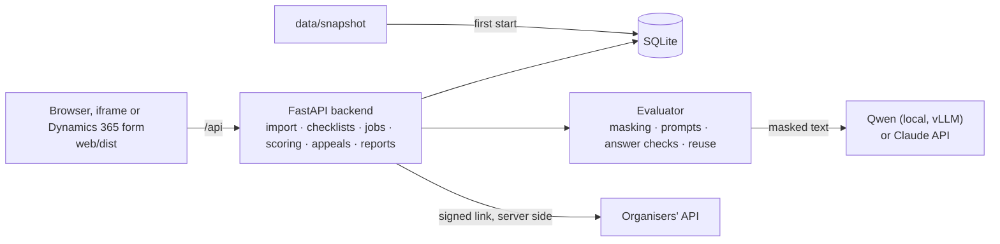

# CQA: Conversation Quality Analytics

**Team: gtbsbe** · Freedom Broker × Nazarbayev University Data Challenge

CQA scores support operators' chats and calls against a configurable checklist, explains every score with evidence from the dialogue, and lets a score be appealed and reviewed. The interface is plain HTML, CSS and JavaScript, built so that it can later run as a component inside Microsoft Dynamics 365.

**The flow:** pick a checklist → evaluate a dialogue → see each criterion's answer, points, explanation and the evidence line in the transcript → a controller appeals one criterion → a model gives the reviewer a second opinion → the reviewer confirms or changes the answer, and the total is recalculated.

## Features

- **Official checklist by default.** The eight-criterion checklist from the organisers, word for word, with its weights, scales, N/A rules and rounding. Teams can build their own checklists; every change creates a new version.
- **Explained scores.** One model call per criterion. Each answer comes with an explanation and the lines of the dialogue it rests on; clicking a criterion jumps to its evidence.
- **Checked in code, scored in Python.** Every answer is validated (allowed values, line numbers, quotes against the transcript). Points, N/A redistribution and rounding are exact arithmetic, never the model.
- **Appeals.** A controller disputes one criterion, the model gives a second opinion, the reviewer decides, and the total is recalculated. Decisions carry over to later evaluations.
- **Cheap re-runs.** Unchanged criteria and weight-only changes reuse stored answers with no model call. A before/after view compares two checklist versions.
- **Calls.** Audio player linked to the transcript, and a «Звонки» checklist that scores intonation and pace from measured pitch, speaking rate, pauses and overlaps.
- **Also:** dialogue info (topic, client mood, outcome), coaching for the operator, translation toggle, analytics, accuracy report, CSV export for Excel, RU / KZ / EN interface, light and dark themes.
- **Privacy.** Personal data is masked before any text reaches a model. The organisers' signed links stay on the backend.

Extras beyond the brief are listed in [`EXTRA_FEATURES.md`](EXTRA_FEATURES.md).

## Run it

You need [`uv`](https://docs.astral.sh/uv/) (it installs Python 3.12 by itself). Node is not needed: the built UI in `web/dist/` is committed.

1. **Install `uv`** (once):
   - Windows PowerShell: `powershell -ExecutionPolicy ByPass -c "irm https://astral.sh/uv/install.ps1 | iex"`
   - macOS or Linux: `curl -LsSf https://astral.sh/uv/install.sh | sh`
2. **Start it:**
   ```sh
   cd backend
   uv run cqa-serve
   ```
   Open <http://127.0.0.1:8000/>. On the first start the stored results in `data/snapshot/` load into a local database, so the queue, scores, appeals, comparisons and export all work **without a model key**. Only new evaluations need a model.
3. **Optional:** copy `backend/.env.example` to `backend/.env` and restart.

| Variable | What it does |
|---|---|
| `ORGANIZER_API_URL` | The organisers' data link; lets the UI import a dataset group |
| `ANTHROPIC_API_KEY` | Needed only for new evaluations, second opinions and translations |
| `ANTHROPIC_BASE_URL`, `DEFAULT_MODEL` | Point the evaluator at the local model instead of the Claude API ([`ops/LOCAL_MODEL.md`](ops/LOCAL_MODEL.md)) |
| `CORS_ORIGINS`, `FRAME_ANCESTORS` | Allow a Dynamics 365 host to call the API and frame the page |

Useful pages once it runs:

- <http://127.0.0.1:8000/>: the app
- <http://127.0.0.1:8000/dynamics-mock.html>: the app inside a mock Dynamics form, 600 px wide
- <http://127.0.0.1:8000/api/export.csv?group_id=DEV>: all results of a group as CSV
- <http://127.0.0.1:8000/api/openapi.json>: the API schema

## Models and results

The main model is **Qwen3.8-27B-FP8**, served locally by vLLM on our own GPU, so no dialogue leaves our machines. The same code runs on the Claude API with a `.env` change.

| Model | Agreement with references (517) | Planted violations found | 65 DEV dialogues | Cost |
|---|---|---|---|---|
| Claude Haiku 5.5 (API) | 80.7% | 21 / 25 | about 11 min | $0.27 |
| Claude Sonnet 5.5 (API) | 79.5% | 23 / 25 | 10 min 40 s | $3.31 |
| **Qwen3.8-27B-FP8 (local)** | **88.2%** | 20 / 25 | 15 min 13 s | $0 |

Same 65 DEV dialogues, official checklist, same evaluator. References are our own labels in `data/reference/`, not the organisers' ground truth. Submitted results: `results/dev/results.json` (DEV) and `results/prod/results.json` (control set).

## How it works

One Python process serves both the static UI and the JSON API.



- **The model answers, Python scores.** The model returns an answer, explanation and evidence per criterion; the backend checks it and computes every number.
- **Reuse instead of re-asking.** Each answer is stored under a key built from everything the model saw, so re-running an unchanged criterion costs nothing and cannot flip at random.
- **One data adapter in the UI.** All requests go through `web/src/api/`; a mock adapter with the same interface lets the UI run without the backend.

Full design: [`ARCHITECTURE.md`](ARCHITECTURE.md). API payloads: [`contract/`](contract/).

## Dynamics 365

The UI can ship as Dynamics **web resources**, as an **iframe** of the hosted page, or later as a **PCF** component, without a rewrite. It uses static files with relative paths, only web-resource file types (the font is inlined into the CSS), passes a strict Content-Security-Policy, scopes all styles under `.cqa`, and works from 600 px wide.

A form script hands the record to the web resource:

```js
formContext.getControl("WebResource_cqa").getContentWindow().then(function (win) {
  win.CQA.setClientApiContext(Xrm, formContext); // opens the dialogue in cqa_conversationid
});
```

As an iframe, pass it in the URL: `index.html?mode=embedded&conversationId=DEV%3Ap1-ru-001&theme=light`. `dynamics-mock.html` shows this working under the strict CSP.

## Repository

```
backend/      Python backend: app/ (API, storage, scoring, appeals), evaluator/ (model calls), audio/, quality/
web/          Front end: src/, tests, and the committed build in dist/
checklists/   The official checklist and our own versions
contract/     JSON Schemas and examples of every API payload
data/         Results snapshot and reference labels (raw data and audio are not committed)
results/      Submitted results for DEV and the control set
ops/          Runbooks: demo, control set, local model
```

## Tests

```sh
cd backend && uv run pytest -q          # backend and evaluator, no paid model calls
cd web && npm ci && npm run check       # unit tests, browser tests, build freshness
```

After any change under `web/`, rebuild the committed UI with `npm run build`.
